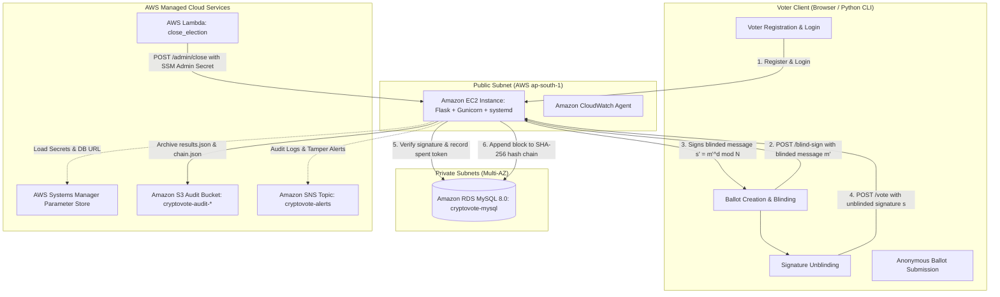

# 🗳️ CryptoVote: Secure Online Voting System with Cryptographic Privacy

[](https://www.python.org/)
[](https://flask.palletsprojects.com/)
[](https://aws.amazon.com/rds/)
[](https://aws.amazon.com/)
[](https://en.wikipedia.org/wiki/Blind_signature)
[](https://en.wikipedia.org/wiki/Hash_chain)

> **Cloud Computing Laboratory Mini Project**  
> An enterprise-grade, privacy-preserving digital voting system engineered on Amazon Web Services (AWS) using David Chaum RSA Blind Signatures, SHA-256 Blockchain-inspired Hash Chaining, and Serverless Cloud Automation.

---

## 🏛️ System Architecture

CryptoVote decouples **voter authentication** from **ballot casting**, guaranteeing complete anonymity while mathematically preventing double voting and database tampering.



---

## 👥 Team Responsibilities & Division of Work

| Role | Team Member | Primary Responsibilities |
|---|---|---|
| **Person A** | Infrastructure Lead (`sara21-g`) | Custom VPC, Public/Private Subnets, Internet Gateway, EC2 Deployment, CloudWatch Agent, Metric Filters & Alarms, Frontend UI. |
| **Person B** | Application & Cryptography Lead (`HarmanSinghArora`) | Flask REST API, Database Schema & Models, David Chaum RSA Blind Signatures, SHA-256 Hash Chain Ledger, AWS Lambda (`close_election`), Amazon SNS Tamper Alerts, Test Automation & Crypto Documentation. |

---

## 🔐 Core Cryptographic Primitives

### 1. David Chaum RSA Blind Signature Scheme (1982)
- **Problem Solved:** How does the election authority verify that a ballot comes from an eligible voter without knowing which candidate they voted for?
- **Protocol:**
  1. **Ballot Hash:** $m = \text{SHA-256}(\text{Candidate ID} \parallel \text{Nonce} \parallel \text{Token})$
  2. **Blinding:** Voter picks secret random $r \in \mathbb{Z}_N^*$. Blinds message:
     $$m' \equiv (m \cdot r^e) \pmod N$$
  3. **Blind Signing:** Server verifies voter identity (must be authenticated, not voted yet), then signs without knowing $m$:
     $$s' \equiv (m')^d \pmod N$$
  4. **Unblinding:** Voter strips the blinding factor:
     $$s \equiv (s' \cdot r^{-1}) \pmod N \equiv m^d \pmod N$$
  5. **Verification on Cast:** Anyone verifies the ballot anonymously using public key $(e, N)$:
     $$s^e \equiv m \pmod N$$

### 2. Double-Voting Prevention
- Each ballot embeds a unique 256-bit anonymous token.
- When cast, $\text{SHA-256}(\text{token})$ is inserted into the `used_tokens` MySQL table with a `UNIQUE` constraint.
- Resubmitting an identical token triggers an immediate **HTTP 409 Conflict**.

### 3. SHA-256 Blockchain Hash-Chain Ledger
- Every vote is appended to the `votes` table linked to its predecessor:
  $$H_0 = 0^{64} \quad (\text{Genesis Hash})$$
  $$H_i = \text{SHA-256}(i \parallel \text{Candidate ID} \parallel \text{Timestamp} \parallel H_{i-1})$$
- If an attacker or rogue administrator modifies any historical vote, `GET /admin/verify-chain` detects the tamper and triggers an **Amazon SNS alert** to security administrators.

### 4. PBKDF2-HMAC-SHA256 Password Security
- Passwords hashed using 100,000 iterations of HMAC-SHA256.
- Unique 16-byte cryptographically secure salt per voter.
- Constant-time verification using `hmac.compare_digest()` prevents timing attacks.

---

## 📡 REST API Specification

| Endpoint | Method | Auth Required | Description |
|---|---|---|---|
| `GET /` | `GET` | None | API Health check & service metadata. |
| `GET /candidates` | `GET` | None | List of approved candidates & parties. |
| `POST /register` | `POST` | None | Register a new voter with PBKDF2-hashed password. |
| `POST /login` | `POST` | None | Authenticate voter; returns session token. |
| `POST /blind-sign` | `POST` | Bearer Token | Sign blinded ballot message $m'$ (Server never sees ballot choice). |
| `POST /vote` | `POST` | Anonymous | Submit anonymous unblinded ballot and cryptographic signature. |
| `GET /receipt/<hash>` | `GET` | None | Verify inclusion of receipt hash in hash-chain ledger. |
| `GET /results` | `GET` | None | Current vote counts per candidate and election status. |
| `GET /admin/verify-chain` | `GET` | None | Recalculate hash chain from genesis; triggers SNS alert if invalid. |
| `POST /admin/close` | `POST` | Admin Secret | Close election, verify chain, and upload audit archives to S3. |

---

## 🚀 Local Development & Quickstart

### Prerequisites
- Python 3.10+
- Git

### 1. Clone & Set Up Virtual Environment
```bash
git clone https://github.com/HarmanSinghArora/cryptovote.git
cd cryptovote
git checkout person-b-backend

python -m venv venv
# Windows:
.\venv\Scripts\activate
# Linux/macOS:
source venv/bin/activate

pip install -r requirements.txt
```

### 2. Initialize Database & Run Server
```bash
python db/init_db.py
python app.py
```
Server runs at `http://127.0.0.1:5000`.

### 3. Run Automated Client Simulation (13 Steps)
In a separate terminal:
```bash
python client.py
```

### 4. Run Test Suites
```bash
python -m unittest tests/test_crypto.py -v
python -m unittest tests/test_api.py -v
python tests/simulate_tamper_and_alert.py
```

---

## ☁️ AWS Cloud Services Utilized

1. **Amazon VPC**: Custom $10.0.0.0/16$ network with 2 Public and 2 Private subnets across `ap-south-1a` and `ap-south-1b`.
2. **Amazon EC2**: Linux instance running Gunicorn WSGI server and managed by `systemd`.
3. **Amazon RDS (MySQL 8.0)**: Managed database in private subnets with automated backup snapshots.
4. **Amazon S3**: Secure audit bucket (`cryptovote-audit-882478410161`) with public access blocked.
5. **AWS Systems Manager Parameter Store**: KMS-encrypted `SecureString` storage for database URLs, credentials, and SNS ARNs.
6. **AWS Lambda**: Serverless Python function (`close_election`) triggered via API/EventBridge.
7. **Amazon SNS**: Push notification topic (`cryptovote-alerts`) dispatching instant email alerts on ledger tampering.
8. **Amazon CloudWatch**: Centralized log aggregation and metric alarms.
9. **AWS IAM**: Least-privilege roles (`CryptoVoteLambdaRole`, `CryptoVoteEC2Profile`).
10. **AWS KMS**: Cryptographic key management for Parameter Store encryption at rest.

---

## 📚 Project Documentation Links

- 📄 [Full Cryptography Report & Proofs](file:///docs/cryptography_report.md)
- 📄 [AWS Cloud Service Justification Matrix](file:///docs/service_justification.md)
- 📄 [Day 2 Coordination Handoff to Person A](file:///coordination/day2_handoff.md)

---

## 🎓 Academic Viva Defense Cheat Sheet

- **Q: How does the system guarantee voter anonymity if registration is mandatory?**  
  *Answer:* *\"We use David Chaum RSA Blind Signatures. During ballot issuance, the voter blinds their choice ($m' = m \cdot r^e \pmod N$). The server signs $m'$ without ever knowing $m$. The voter unblinds the signature locally ($s = s' \cdot r^{-1} \pmod N$) and submits the vote anonymously through a separate session. The database `votes` table has no `voter_id` foreign key.\"*

- **Q: How is double-voting prevented without linking voter identity to the ballot?**  
  *Answer:* *\"Each ballot includes a random 256-bit token. When submitted, the SHA-256 hash of this token is recorded in the `used_tokens` table, which enforces a `UNIQUE` constraint. Re-submitting the same token triggers an immediate HTTP 409 Conflict rejection.\"*

- **Q: What happens if a malicious database administrator alters a vote in MySQL?**  
  *Answer:* *\"Every vote is linked into a SHA-256 hash chain where each block contains the hash of the preceding block. If an administrator alters a vote, `GET /admin/verify-chain` detects that the recomputed hash does not match the stored hash, flags the corrupted block, and immediately triggers an Amazon SNS email alert to security operators.\"*

- **Q: Why is Lambda used instead of a simple cron job on EC2 for closing elections?**  
  *Answer:* *\"Decoupling election closure to AWS Lambda guarantees that election termination is event-driven and isolated from the web server. Lambda fetches the admin secret from encrypted Parameter Store, triggers the closure, exports results to S3, and incurs zero compute cost when idle.\"*

---

## 📜 License
Developed for academic laboratory evaluation. MIT License.
