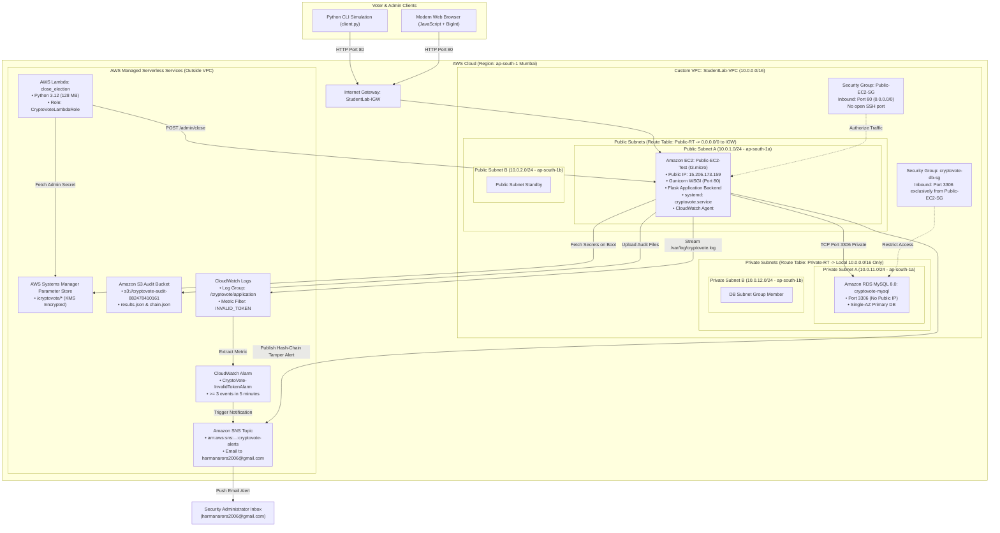

# CryptoVote: Cloud Architecture & System Design Specification
**Project:** CryptoVote – Secure Online Voting System  
**Region:** `ap-south-1` (Mumbai)  
**Author:** Solo Cloud Architect & DevOps Lead (Harman Singh Arora)  
**Course:** Cloud Computing Laboratory Mini Project 2026  

---

## 1. High-Level AWS Cloud Architecture

CryptoVote is built upon a defense-in-depth, decoupled cloud architecture following the AWS Well-Architected Framework:



---

## 2. End-to-End Cryptographic Data Flow

### A. David Chaum RSA Blind Signature & Anonymous Voting Protocol

```mermaid
sequenceDiagram
    autonumber
    actor Voter as Voter Client (Browser / CLI)
    participant Server as Flask Backend (EC2)
    participant DB as RDS MySQL (Private)
    participant SNS as Amazon SNS Topic

    Note over Voter,Server: Phase 1: Authentication & Ballot Blinding
    Voter->>Server: POST /login {voter_id, password}
    Server->>DB: Query voter & verify PBKDF2 hash (100k rounds)
    Server-->>Voter: HTTP 200 {token: session_token, has_requested_ballot: false}

    Voter->>Server: GET /crypto/public-key
    Server-->>Voter: HTTP 200 {e: 65537, n: 2048-bit modulus}

    Note over Voter: Client generates ballot token T and secret blinding factor r<br/>m = SHA256(candidate:1; token:T) mod N<br/>m' = (m * r^e) mod N

    Note over Voter,Server: Phase 2: Blind Signing (Identity Known, Vote Choice HIDDEN)
    Voter->>Server: POST /blind-sign {blinded_message: m'} (Bearer session_token)
    Server->>DB: Check voter.has_requested_ballot == false
    Server->>DB: Update voter.has_requested_ballot = true
    Note over Server: Server computes: s' = (m')^d mod N<br/>Server signs without ever viewing message m!
    Server-->>Voter: HTTP 200 {blind_signature: s'}

    Note over Voter: Phase 3: Client-Side Unblinding<br/>s = (s' * r^-1) mod N = m^d mod N

    Note over Voter,Server: Phase 4: Anonymous Ballot Submission
    Voter->>Server: POST /vote {candidate_id: 1, token: T, signature: s}<br/>(Zero voter ID or session headers sent!)
    Server->>Server: Verify RSA signature: s^e mod N == m
    Server->>DB: Check token T in used_tokens (UNIQUE constraint)
    Server->>DB: Append block to SHA-256 hash chain in votes table
    Server-->>Voter: HTTP 200 {receipt_hash: Block Hash, block_index: 1}

    Note over Voter,Server: Phase 5: Tampering Detection & SNS Alerting
    actor Auditor as Security Auditor
    Auditor->>Server: GET /admin/verify-chain
    Server->>DB: Recalculate SHA-256 hashes from Genesis
    alt Hash Chain Intact
        Server-->>Auditor: HTTP 200 {is_valid: true, total_blocks: N}
    else Tampering Detected (Block hash mismatch)
        Server->>SNS: Publish urgent security alert
        SNS-->>Auditor: Push Email: "CRITICAL: Hash Chain Tampering Detected!"
        Server-->>Auditor: HTTP 200 {is_valid: false, details: {block_index: X}}
    end
```

---

## 3. Component Network Placement & Boundaries

| Component | Network Domain | Subnet & CIDR | Public Route? | Security Boundary |
|---|---|---|---|---|
| **EC2 Web Server** | Custom VPC | `Public-Subnet-A` (`10.0.1.0/24`) | **Yes** (via IGW) | Port 80 open; no inbound SSH; outgoing access via IGW. |
| **Amazon RDS MySQL** | Custom VPC | `Private-Subnet-A` (`10.0.11.0/24`) & `Private-Subnet-B` (`10.0.12.0/24`) | **No** (Local only) | Inbound Port 3306 restricted strictly to `Public-EC2-SG`. No public IP. |
| **AWS Systems Manager** | AWS Managed Endpoint | Outside VPC | Public AWS API | Encrypted HTTPS (TLS 1.3), authenticated via IAM STS temporary credentials. |
| **Amazon S3** | AWS Storage Tier | Outside VPC | Public AWS API | S3 Public Access Blocked; restricted to IAM PutObject policies. |
| **AWS Lambda** | AWS Serverless | Outside VPC | Public AWS API | Serverless microVM container with `CryptoVoteLambdaRole`. |
| **Amazon SNS** | AWS Messaging Tier | Outside VPC | Public AWS API | Topic restricted to IAM publishers; email push over TLS. |
| **CloudWatch Logs** | AWS Management Tier | Outside VPC | Public AWS API | CloudWatch Agent pushes encrypted log streams from `/var/log/cryptovote.log`. |

---

## 4. Verification Checklist
- [x] All 12 required AWS services depicted with actual IDs and configuration.
- [x] Clear separation between Custom VPC internal subnets and AWS serverless tiers.
- [x] Zero open SSH ports (management via AWS Systems Manager Session Manager).
- [x] Database completely shielded in multi-AZ private subnets with zero internet ingress.
